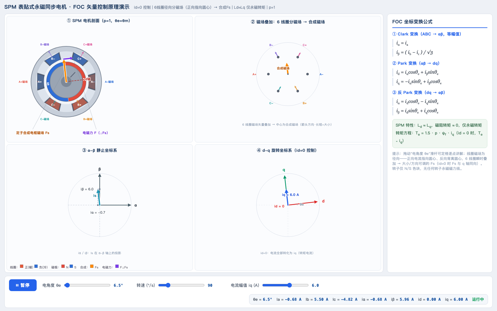

# SPM 永磁同步电机 FOC 矢量控制原理演示

> 纯 **Canvas 2D** 单文件交互式教学演示 · 6 线圈磁场矢量合成 · id=0 控制  
> 无任何外部依赖，双击 `index.html` 即可运行，适合课堂讲解 / 答辩展示 / 作品集




---

## ✨ 这是什么

一个面向 **SPM（表贴式永磁同步电机）FOC 矢量控制** 的可视化教学演示。它把课本上抽象的
"6 个线圈磁场叠加成旋转磁场" 拆开：先看每个线圈自己的磁场矢量，再看它们叠加出的合成电枢磁场
`Fs`，最后看 `Fs` 与转子永磁体相互作用产生的电磁力 `F`——并同步对照 Clark / Park 变换下的
α-β、d-q 坐标系矢量关系。

页面布局：

| 区域 | 内容 |
| --- | --- |
| ① 左上 | **SPM 电机剖面**：6 个线圈（A+ A− B+ B− C+ C−）、各线圈分磁场矢量、圆心出发的合成磁场 `Fs`、⊥Fs 的电磁力 `F`、随电角度旋转的 N/S 转子 |
| ② 右上 | **磁场叠加**：6 个线圈的径向磁场矢量（长度 ∝ 电流、正负翻转指向）→ 中心合成磁场箭头 |
| ③ 左下 | **α-β 静止坐标系**：α/β 轴、总电流矢量 `Is` 及其投影 `iα`、`iβ`，左下角图例 |
| ④ 右下 | **d-q 旋转坐标系**：d/q 轴随 θe 旋转，`id = 0`，电流全部为 `iq`（iq 用蓝色与 q 轴区分） |
| ⑤ 最右 | **FOC 公式面板**：Clark / Park / 反 Park 变换 + SPM 特性说明 |
| 底部 | 启停、电角度、转速、电流幅值控件 + 实时状态（θe、Ia/Ib/Ic、iα/iβ、id/iq） |

---

## 🔬 物理模型（演示所遵循的规则）

**6 个线圈，两两对置成对**，沿圆周每 60° 一个，构成三相：

```
A+ ↔ A−      B+ ↔ B−      C+ ↔ C−
角度：0°, 60°, 120°, 180°, 240°, 300°
```

**单个线圈的磁场矢量**（径向）：

- 电流为 **正** → 箭头 **指向圆心**
- 电流为 **负** → 箭头 **背离圆心**
- 矢量长度 ∝ 该线圈电流大小 `|i|`（细、半透明、6 色区分）

**磁场叠加**：6 个线圈矢量首尾相加，得到定子合成电枢磁场 `Fs`：

```
Fs = Σ (−i_k · u(a_k)) = 3 · Is · u(θe + 90°)
```

`u(a)` 为角度 a 处的径向单位矢量，`a_k = 0°, 60°, …, 300°`。
id = 0 控制时 `Fs` 与 q 轴同向、`|Fs| ∝ iq`。

**电磁力**：`Fs` 对转子永磁体的作用力 `F` 与 `Fs` 垂直，箭头起点固定在 `Fs` 箭头尖处，
长度 ∝ `|iq|`，随电流正负翻转指向。

**SPM 特性**：

- `Ld ≈ Lq`，磁阻转矩 ≈ 0，仅永磁转矩
- `Te = 1.5 · p · ψf · iq`（id = 0 时 `Te ∝ iq`）
- 转子只绘制 N/S 色块与铁芯轮廓，**不绘制任何转子永磁体磁力线**；画面中的磁场矢量全部来自定子线圈

---

## 🎛 交互说明

| 控件 | 作用 |
| --- | --- |
| `⏸ 暂停 / ▶ 启动` | 开启 / 关闭转子自动旋转动画 |
| **电角度 θe** 滑杆 | 手动设定电角度，拖动时自动暂停 → **定格讲解**；电机、线圈磁场、合成 `Fs`、电磁力、αβ/dq 全部同步刷新 |
| **转速 (°/s)** 滑杆 | 调节自动模式下的旋转速度（30–360 °/s） |
| **电流幅值 iq (A)** 滑杆 | 统一调节定子电流幅值，所有线圈磁场箭头长度、`Fs` 长短同步缩放 |
| 状态区 | 实时显示 θe、Ia/Ib/Ic、iα/iβ、id/iq 与运行状态 |

> 演示中保持 `id = 0` 经典控制策略，电流矢量始终锁定在 q 轴。

---

## 🚀 本地运行

三种方式任选：

1. **直接双击** `index.html`（推荐，双击即用，无需服务器）；
2. 本地静态服务器：

   ```bash
   python3 -m http.server 8080
   # 浏览器打开 http://localhost:8080
   ```

3. 拖进任意浏览器窗口。

兼容 Chrome / Edge / Safari / Firefox 最新版本。

---

## 🌐 发布到 GitHub Pages

### 方式 A：从分支直接部署（最简单）

1. 在 GitHub 新建仓库（例如 `spm-foc-demo`，**不要**勾选初始化 README）；
2. 在本目录执行：

   ```bash
   git init
   git add .
   git commit -m "feat: SPM FOC 矢量控制交互演示"
   git branch -M main
   git remote add origin git@github.com:<你的用户名>/spm-foc-demo.git
   git push -u origin main
   ```

3. 打开仓库 **Settings → Pages**，Source 选择 **Deploy from a branch**；
4. Branch 选 `main`、目录选 `/ (root)`，点击 **Save**；
5. 等待 1 分钟左右，访问：

   ```
   https://<你的用户名>.github.io/spm-foc-demo/
   ```

### 方式 B：GitHub Actions（仓库已内置 workflow）

仓库包含 `.github/workflows/pages.yml`，推送到 `main` 后会自动构建并发布。
在 **Settings → Pages → Source** 选择 **GitHub Actions** 即可。

---

## 📁 目录结构

```
spm-foc-demo/
├── index.html              # 演示主文件（全部 HTML/CSS/JS 内嵌，单文件）
├── preview.png             # 预览截图（README 使用）
├── favicon.svg             # 站点图标
├── README.md
├── LICENSE                 # MIT
├── .gitignore
└── .github/
    └── workflows/
        └── pages.yml       # GitHub Pages 自动部署
```

---

## ⚙️ 常用自定义参数（`index.html` 内搜索即可）

| 参数 | 位置 | 说明 |
| --- | --- | --- |
| `IMAX = 10` | 脚本顶部 | 电流幅值滑杆上限（A），影响归一化 |
| `state = { theta, speed, iq, running }` | 脚本顶部 | 初始电角度 / 转速 / iq / 是否自动运行 |
| `SIDES` 数组 | 脚本顶部 | 6 个线圈的角度、标签、相索引、电流符号、颜色 |
| `const R = Math.min(...)` | 各 `drawXxxCell()` | 电机 / 坐标系半径的自适应系数 |
| `loops`、颜色常量 | `drawStatorField` 等 | 矢量颜色、长度比例 |
| 滑杆范围 | HTML `input[type=range]` | θe / 转速 / iq 的取值范围与步长 |

---

## 🧮 坐标变换公式

**Clark 变换（等幅值）**

```
iα = ia
iβ = (ib − ic) / √3
```

**Park 变换**

```
id =  iα·cosθe + iβ·sinθe
iq = −iα·sinθe + iβ·cosθe
```

**反 Park 变换**

```
iα = id·cosθe − iq·sinθe
iβ = id·sinθe + iq·cosθe
```

转矩方程：`Te = 1.5 · p · ψf · iq`（id = 0 时 `Te ∝ iq`）。

---

## 🧱 技术实现要点

- **4 个独立 `<canvas>`**（电机剖面 / 磁场叠加 / α-β / d-q），CSS Grid 2×2 自适应布局；
- 所有图形由 Canvas 2D 原生 API 绘制（矢量、圆弧、渐变磁力线、标注等），**零第三方库**；
- 按 `devicePixelRatio` 缩放画布保证高分屏清晰，`ResizeObserver` 自适应窗口；
- 单一 `requestAnimationFrame` 主循环驱动全部画布与状态刷新；
- 所有数学采用"0° 向右、逆时针为正"约定（`polar()` 内部处理画布 y 轴翻转）。

---

## 📄 License

[MIT](LICENSE) © 2026 sfyth

> 仅用于教学演示与学习交流，物理模型为课堂讲解做了适当简化。
